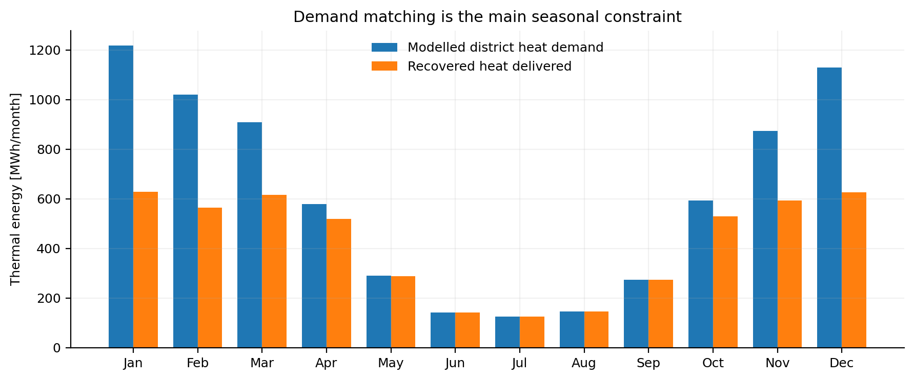
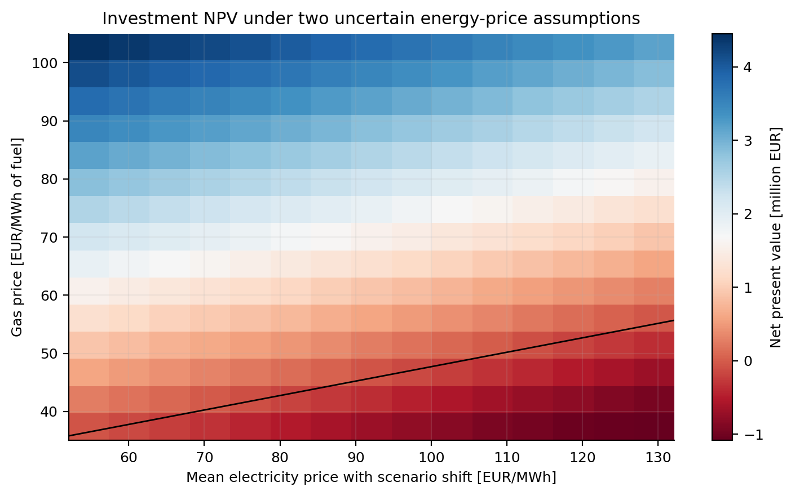
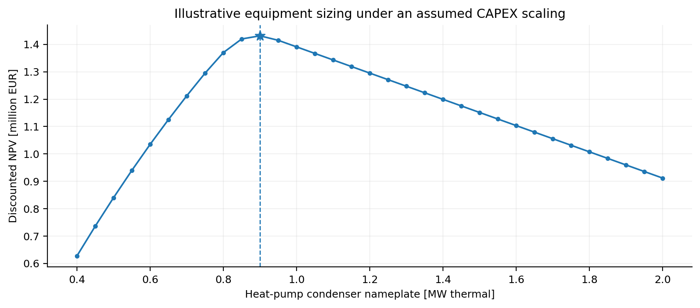

# Data-centre waste heat recovery: a screening study

**Can low-grade heat from a 1 MW IT data centre contribute to district heating, and under which conditions does it make technical and economic sense?**

I developed a reproducible hourly model to study that question, combining heat-pump thermodynamics with heat-demand matching and a discounted cash-flow assessment. The model accounts for compressor electricity, network delivery losses, available heat at the source, heat-pump capacity, and the hourly decision to recover heat or use the reference boiler.

> **Scope:** This is a *screening model*, not a plant feasibility study. The bundled reference scenario uses synthetic prices and temperatures. A separate 2025 run uses observed Danish DK2 wholesale electricity prices and DMI Kastrup air temperatures (with 13 explicitly interpolated weather hours), while IT load, heating-demand coefficients, heat-pump performance, capital costs, and gas-boiler counterfactual remain modelling assumptions. The published technical report and eight reference figures describe the synthetic benchmark; they should not be mistaken for historical-data results.

## Why this question matters

The IEA's 2026 *Key Questions on Energy and AI* projects global data-centre electricity consumption of about 950 TWh in 2030 (from approximately 485 TWh in 2025). Data centres turn most purchased electricity into low-grade heat. That heat has some potential value, but the question is not simply how much is available: a district network must need it at the right time and temperature, and the costs of upgrading and delivering it must be justified. See [SOURCES](docs/SOURCES.md).

## System boundary

```text
       1 MW installed IT power                 District network (seasonal demand)
           |                                          ^
           v                                          | Q_useful
  IT load × heat-capture fraction                 3% assumed heat losses
           |                                          ^
           | Q_source                                 |
           +--------> EVAPORATOR / HEAT PUMP ----> CONDENSER
                          ^                Q_hot = Q_source + W_comp
                          | W_comp
                     electricity
                          + additional circulation pump electricity

  Counterfactual: a gas boiler generates the same district heat Q_useful.
```

**Boundary decisions:** PUE is reported only for background data-centre electricity use; that overhead is not counted as recovered heat. Pumping electricity is included as additional purchased electricity but is not credited as useful heat. Avoided data-centre cooling electricity is **not** assumed. Investment comparisons therefore exclude any speculative cooling savings.

## What is in the repository?

- `src/heat_reuse/physics.py` — reversible thermodynamic limits, heat-source/capacity constraints and energy balance.
- `src/heat_reuse/profiles.py` — synthetic (clearly labelled) hourly demand, load, weather and price profiles.
- `src/heat_reuse/simulation.py` — demand-constrained and source-constrained hourly operation, cost-based dispatch, operational emissions.
- `src/heat_reuse/economics.py` — operating savings, simple payback, NPV, break-even heat value.
- `src/heat_reuse/studies.py` — temperature/capture scenarios, price sensitivity, an explicitly non-probabilistic parameter sweep, and a heat-pump sizing screen.
- `src/heat_reuse/observed.py` and `scripts/fetch_real_inputs.py` — validated imports of DMI measured weather and Energinet DK2 wholesale spot prices; explicit DST handling and imputation flags.
- `tests/` — validation of equations, constraints, price-data coverage and economic counterfactuals.
- `report/technical_report.pdf` — report with methodology, equations, figures and critical discussion.
- `docs/` — model assumptions, data notes, limitations and source bibliography.

## Quick reproduction

Python 3.10+:

```bash
python3 -m venv .venv
source .venv/bin/activate
pip install -r requirements.txt
python run.py
PYTHONPATH=src python -m pytest -q
```

`python run.py` writes `results/hourly_results.csv`, `results/summary.json`, `results/scenario_comparison.csv`, `results/assumption_sweep.csv`, `results/capacity_sizing.csv`, and regenerates all eight figures in `figures/`.

## Results: reference assumptions only

<!-- AUTOGENERATED SUMMARY START -->
Reference output: **5.05 GWh/year** useful heat delivered, mean *running* COP **4.01**, **69.1%** of modelled district heat demand covered. Incremental operating cash flow is **EUR 190.7k/year**, with **20-year NPV EUR 1.32m** and **simple payback 4.30 years**, all conditional on assumed tariffs, capital costs and boiler counterfactual. Conditional operational carbon difference: **938 tonnes CO2 per year avoided**, not a lifecycle result.
<!-- AUTOGENERATED SUMMARY END -->







### Historical price and weather study: Denmark, 2025

A second configuration, `config.real-2025.json`, uses downloaded 2025 Danish input data: **Energinet DK2 day-ahead wholesale electricity prices** (hourly prices through the 1 October 2025 market transition and four quarter-hour prices averaged thereafter), and **DMI Kastrup station hourly mean air temperature**. Weather observations are mapped to the hour they describe, rather than the hour when the observation was reported. Among 8,760 hourly weather values, **13 hours (0.15%) were filled by explicitly flagged, short-gap linear interpolation using measured neighbours**. These are not 8,760 independently measured temperature values.

| Metric | Synthetic reference | Observed-price/weather boundary conditions |
|---|---:|---:|
| Annual modelled district heating demand | 7,302 MWh | 6,467 MWh |
| Useful heat delivered | 5,048 MWh | **4,861 MWh** |
| Mean running COP | 4.005 | **4.064** |
| Share of modelled heat demand covered | 69.1% | **75.2%** |
| Additional electricity cost | EUR 125,571/yr | **EUR 114,568/yr** |
| 20-year NPV of assumed boiler-displacement savings | EUR 1.319m | **EUR 1.301m** |

The historical-boundary run was executed on a contributor's computer after retrieving both datasets. **No measured district-heat demand, data-centre heat source, or equipment performance was supplied.** Thus the increased heat-demand coverage reflects a changed weather-driven *demand estimate*, not a measurement that the real network is better served. The positive NPV is an assumed gas-boiler cost-avoidance calculation, **not** an investor's heat-sale revenue projection or a bankable valuation. DMI's metObs readings are raw station observations and not a quality-controlled climate record.

The historical inputs and generated outputs must be checked into the repository to make this specific run reproducible without downloading them again. The following commands regenerate it after the inputs are available:

```bash
python scripts/fetch_real_inputs.py --year 2025
python run.py --config config.real-2025.json --out results/real-2025
python scripts/plot_observed_inputs.py --year 2025
python scripts/compare_runs.py --reference results/summary.json --observed results/real-2025/summary.json
```

See the [observed-data methodology](docs/OBSERVED_DATA_2025.md) and the machine-generated input provenance / SHA-256 metadata in `data/observed/observed_2025.metadata.json`. Do not substitute synthetic prices or weather if a provider download fails.

An additional **discrete capacity-sizing screen** suggests that around **0.90 MW** would be more economical than 1.15 MW *in the reference scenario under a hypothetical linear CAPEX model*. This is not an equipment recommendation; the result would need real quotations and operating constraints.

The central lesson is that **heat availability, temperature lift, seasonal demand and relative gas/electricity costs all matter**. A more efficient heat pump need not export more heat if the evaporator is source-limited. In the sensitivity study, some parameter combinations produce negative NPV; a positive reference result is not evidence that the investment is necessarily attractive in practice.

## Research limitations

1. Bundled benchmark uses synthetic IT load, ambient temperature, heat demand and prices; the separate historical runner can use observed weather and prices after downloads, but does not measure plant demand or IT load. No false precision should be attached to those curves.
2. Heat pump COP uses a constant second-law efficiency and a temperature-lift relation, not a compressor manufacturer's part-load performance map or refrigerant model.
3. A constant delivery efficiency replaces pipe heat-loss, hydraulics and heat-exchanger sizing; no minimum turndown or thermal storage is represented.
4. Gas boiler displaced at the margin: a different reference heat supply, marginal electric generation mix, gas price, or district tariff changes the comparison.
5. No regulatory approval, network interconnection quotation, ownership contract, installation schedule, uncertainty-calibrated probability forecast or operational measurements.

## Next validation step

The single most useful next step is to obtain **measured hourly district heating demand and source temperatures** (with permission), plus an equipment COP map and actual investment/contract costs. Weather and market-price observations have now been used in a 2025 sensitivity run, but do not validate any unobserved physical or commercial quantities. See [docs/OBSERVED_DATA_2025.md](docs/OBSERVED_DATA_2025.md).

## Literature and data

References with persistent original URLs are listed in [docs/SOURCES.md](docs/SOURCES.md). The model follows a teaching-oriented modelling philosophy: physical constraints and system boundaries first, economics second, and clear limitations throughout.
