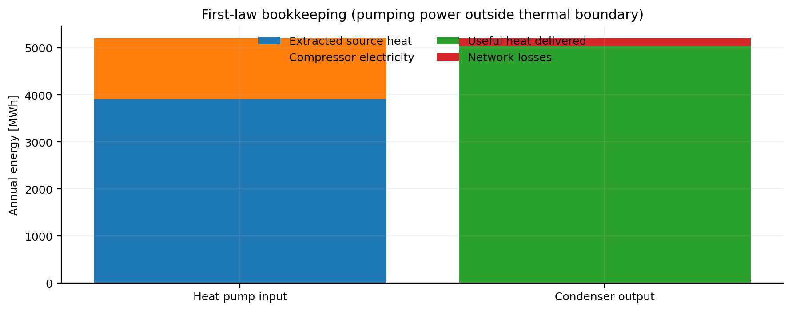
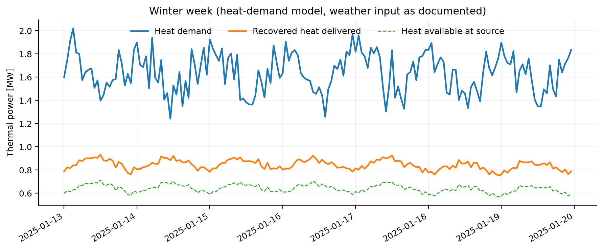
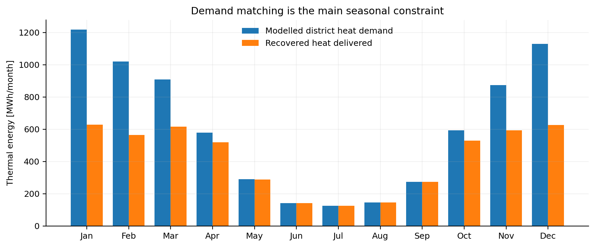
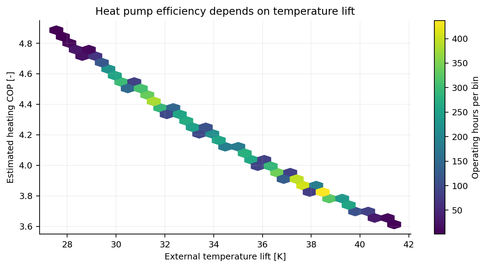
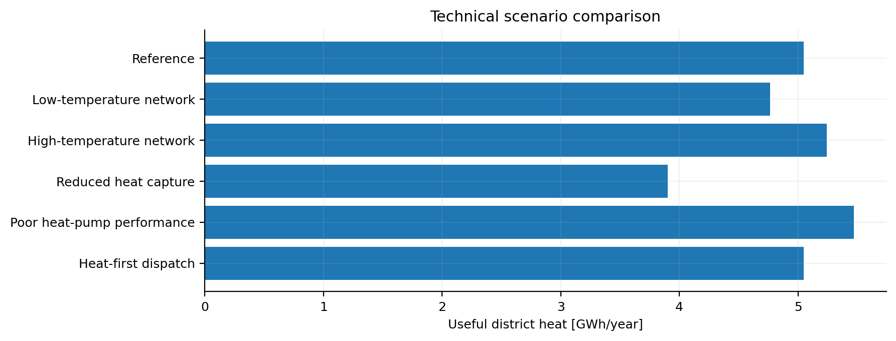
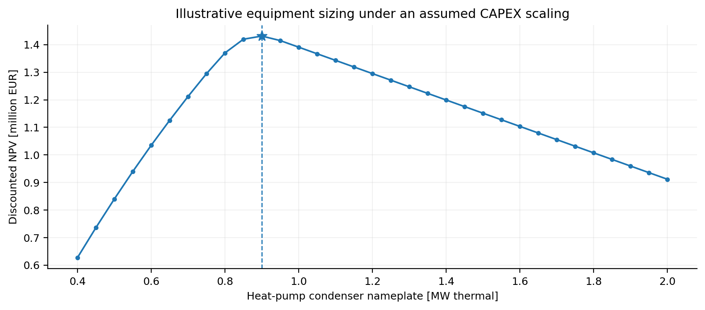
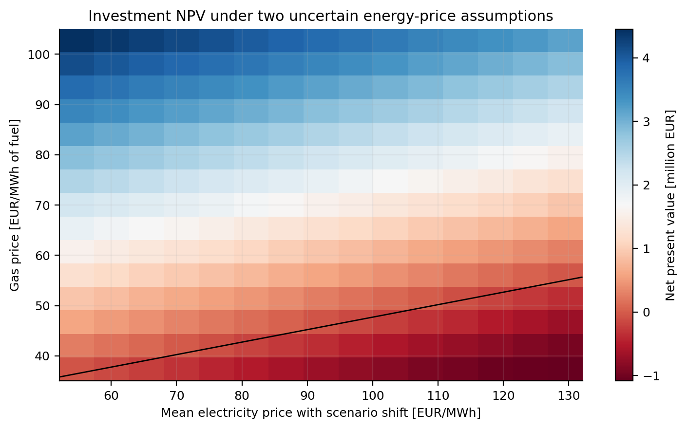
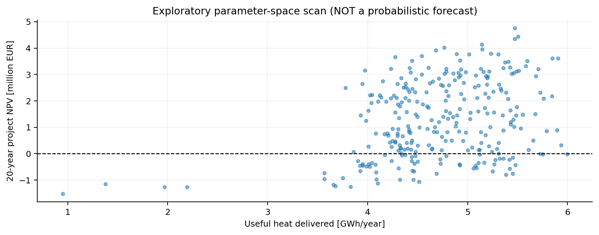

**STUDY STATUS — CONDITIONAL MODEL.** The case considered here is hypothetical. The load, ambient temperature, heating demand, temperatures, equipment efficiencies, prices, emission factors and installed costs in the reference dataset are assumptions. None are presented as measurements from an operating data centre or Danish district-heating utility. The full calculation is reproducible; physical validation remains an open task.

# 1. Motivation and precise research question

Data centres are an unusually interesting thermal-energy problem. Their electrical demand is significant and rising; the IEA's 2026 *Key Questions on Energy and AI* gives approximately 485 TWh globally in 2025 and projects around 950 TWh for 2030 [1]. Although most electrical input ends up as heat, it is normally available at relatively low temperature. A nearby heating network may operate at a significantly higher temperature, particularly in winter when heating demand is strongest. The useful question is therefore **not how much waste heat a data centre produces**, but how much is delivered at the right temperature and time, and what that delivery costs.

I built a model to answer three connected questions:

1. How much source heat is available at the IT cooling-loop boundary, and how much can be upgraded and delivered to a heating network once physical and demand limits are respected?
2. How does the network supply temperature affect heat-pump performance, electricity consumption, recoverable thermal output and coincident heat delivery?
3. When is substitution of an assumed gas-boiler source valuable after additional electricity consumption, operating costs and capital expenditure?

The scope is a **screening exercise**, intended to reveal sensitivities and feasibility conditions before a detailed plant design. It does not optimize a refrigerant cycle or simulate a complete district-heating network.

# 2. System boundary and counterfactual

A hypothetical installation has 1 MW installed electrical IT capacity. The actual IT power varies hourly. A specified fraction of IT power is available as recoverable source heat in a cooling-fluid loop. A mechanical heat pump extracts heat from that loop and raises it to a weather-dependent district-heating supply temperature. Only the amount that matches simultaneous demand is dispatched. Any demand not covered by recovered heat is met by an existing gas boiler in the *reference* system.

This distinction matters economically. A MWh of heat that is technically recoverable but has no customer at that hour does not displace a MWh of fuel. Likewise, compressor electricity is not zero: it appears as additional purchased energy in the plant boundary. Pumping power is counted as purchased electrical energy but **is not added to thermal output** (a conservative simplification that avoids creating fictitious useful heat).

The European Commission defines PUE and energy reuse factors within specific data-centre reporting boundaries [2], and ASHRAE advises considering heat recovery where a viable sink exists [3]. In this study PUE is used only as contextual information: **PUE overhead is not added to recoverable IT heat**, and no certified ERF or ERE is claimed. Possible savings from reduced original cooling-system power are also excluded because the data needed to justify them are unavailable.

{ width=88% }

## 2.1 Reference parameters

| Engineering parameter | Reference assumption |
|:---|---:|
| Installed IT capacity | 1.00 MW electric |
| Mean IT utilization before hourly variation | 0.83 |
| Recoverable IT heat fraction | 0.78 |
| Reference source-fluid temperature | 33 °C |
| Heat-pump rated condenser output | 1.15 MW thermal |
| Heat-pump second-law efficiency | 0.50 |
| Evaporator / condenser approach | 4 K / 3 K |
| Nominal district supply temperature | 68 °C |
| Heat delivery efficiency | 0.97 |
| Pump electricity per condenser heat | 0.018 MW electric / MW thermal |
| Reference PUE (background only) | 1.25 |

These choices give a tractable numerical example; they are **not equipment specifications or plant observations**. The efficiency relation should eventually be replaced by a calibrated manufacturer performance map.

# 3. Thermodynamic model

## 3.1 Capturable source heat

For each hour $t$, installed IT electrical capacity $P_{IT,r}$ and utilization $u_t$ determine IT power. The capturable thermal power is a bounded fraction $f_{cap}$:

$$
P_{IT,t}=P_{IT,r}u_t,\qquad
\dot Q_{s,avail,t}=f_{cap}P_{IT,t}.
$$

The upper bound applies before imposing district demand. Even though almost all purchased IT power eventually degrades to thermal energy, some may be unavailable at the desired capture point. The chosen capture fraction represents that uncertainty, not a validated physical design. The model never collects more heat than this defined source stream.

## 3.2 Heat-pump efficiency and temperature lift

For an evaporator temperature $T_{e,t}$ and condenser temperature $T_{c,t}$ **expressed in kelvin**, the theoretical heating coefficient of performance is

$$
COP_{C,t}=\frac{T_{c,t}}{T_{c,t}-T_{e,t}}.
$$

Approach temperatures approximate the refrigerant-to-fluid differences:

$$
T_{e,t}=T_{source,t}-\Delta T_e,\qquad
T_{c,t}=T_{DH,t}+\Delta T_c.
$$

A constant second-law efficiency $\eta_{II}$ supplies the reduced-order COP estimate:

$$
COP_t=\eta_{II}\,COP_{C,t},\quad\eta_{II}=0.50\quad\text{(assumed)}.
$$

This formulation retains the correct direction of the temperature-lift effect and ensures COP stays beneath Carnot. A high source temperature or a low network temperature reduces the lift and improves COP. The IEA DHC guidance discusses the importance of network operating temperatures for heat-pump efficiency [4]. **A constant second-law efficiency is not an accurate part-load refrigerant model:** real cycles require performance curves, refrigerant constraints, pinch temperatures and capacity corrections.

## 3.3 Energy conservation and simultaneous constraints

At every operating hour, condenser heat is the sum of evaporator heat and compressor electrical input:

$$
\dot Q_{h,t}=\dot Q_{s,t}+P_{comp,t},\qquad
COP_t=\frac{\dot Q_{h,t}}{P_{comp,t}}.
$$

Rearranging gives the source requirement for a chosen heating output:

$$
\dot Q_{s,t}=\dot Q_{h,t}\left(1-\frac{1}{COP_t}\right).
$$

The permissible condenser output is the minimum of three *independent* limits: installed heat-pump capacity, available source heat and coincident demand corrected for delivery losses:

$$
\dot Q^{max}_{h,t}=\min\left[\dot Q_{h,r},\;
\dot Q_{s,avail,t}\frac{COP_t}{COP_t-1},\;
\frac{\dot Q_{demand,t}}{\eta_d}\right].
$$

The exported heat, heat loss and additional electrical input are

$$
\dot Q_{del,t}=\eta_d\dot Q_{h,t},\quad
\dot Q_{loss,t}=(1-\eta_d)\dot Q_{h,t},
$$

$$
P_{extra,t}=\underbrace{\frac{\dot Q_{h,t}}{COP_t}}_{\mathrm{compressor}}+
\underbrace{f_{pump}\dot Q_{h,t}}_{\mathrm{circulation}}.
$$

Thus, the model verifies two independent identities every hour:

$$
\boxed{\dot Q_{source}+P_{comp}=\dot Q_{condenser}},
\qquad
\boxed{\dot Q_{condenser}=\dot Q_{delivered}+\dot Q_{loss}}.
$$

With a one-hour time step, 1 MW sustained during one interval corresponds to 1 MWh. If the simulator violates a thermal identity or delivers more heat than is demanded, it terminates with an error rather than producing a result.

## 3.4 Hourly operating decision

Because this model has **no thermal storage**, its hourly dispatch is independent across time steps. The reference gas boiler uses fuel at cost $c_g$ EUR/MWh of fuel, with efficiency $\eta_b$, so avoided cost per MWh useful heat is $c_g/\eta_b$. Heat recovery operates if this exceeds the incremental variable cost:

$$
\frac{c_g}{\eta_b} >
\frac{p_{el,t}(1/COP_t+f_{pump})}{\eta_d}+c_{OM,var}.
$$

Otherwise, the heat pump stays off and the reference boiler supplies that hour's heat. An alternative `heat_first` policy exports all technically possible heat irrespective of hourly marginal cost; comparing the two policies identifies the price of prioritizing physical recovery over short-run economics. Fixed O&M and capital costs enter the *investment* analysis rather than this hourly marginal rule.

# 4. Profiles, units and reproducibility

The baseline covers the **8,760 UTC hours of 2025**. IT load follows an hourly and weekly variation around a stated mean. Ambient temperature is a synthetic annual sinusoid with daily oscillation and reproducible random perturbations. District demand increases below a heating-balance temperature and retains a small hot-water base load. Supply temperature follows a synthetic weather-compensated reset. Electricity prices include daily/seasonal variations and fixed-seed perturbations.

**No observed Copenhagen heat-demand, weather, IT load or energy-price series is embedded in the reference simulation.** The design is reproducible offline and has deliberately labelled input assumptions. This avoids the common mistake of attaching precise plots to undocumented or invented measurements.

Energinet publishes Danish market prices via Energi Data Service [5]. The repository includes an **optional**, separate importer for the `DayAheadPrices` dataset, covering the 15-minute market resolution. Its data-processing logic uses UTC and averages four quarter-hour observations into one hourly market price. The import rejects incomplete or duplicated timestamps rather than silently interpolating. The bundled run does **not** use this downloaded dataset, and no successful historical data download is claimed.

{ width=94% }

# 5. Annual technical results

| Metric from baseline calculation | Model result |
|:---|---:|
| District heat demand | **7,302 MWh/year** |
| Useful recovered heat delivered | **5,048 MWh/year** |
| District demand coverage | **69.1%** |
| Heat extracted from source loop | **3,905 MWh/year** |
| Compressor electricity purchased | **1,299 MWh/year** |
| Circulation electricity purchased | **94 MWh/year** |
| Mean COP *during operation* | **4.01** |
| Rated heat-output capacity factor | **51.7%** |

The annual first-law check is directly interpretable: approximately 3,905 MWh of source heat plus 1,299 MWh of compressor electricity creates 5,204 MWh at the condenser. After approximately 156 MWh of network losses, about 5,048 MWh is credited as useful customer heat. The separate 94 MWh of circulation electricity is included in operating costs and emissions. Results above are rounded; the hourly CSV contains the unrounded values.

{ width=92% }

The strong seasonal mismatch is worth emphasizing: a data centre generates heat year-round, but a district-heating network needs much more heat in winter. A model that multiplies annual IT electricity by a recovery percentage without modelling coincident demand would overstate useful delivery. The chosen network demand also exceeds the feasible source-and-capacity-limited output during several winter hours, so full demand coverage cannot be claimed.

{ width=85% }

# 6. Comparison of alternative operating conditions

Several controlled model changes isolate the physical effect of supply temperature, available heat and heat-pump efficiency. Financial assumptions otherwise remain identical.

| Scenario | Delivered heat [GWh/year] | Running COP | 20-year NPV [M EUR] |
|:---|---:|---:|---:|
| Reference | 5.05 | 4.01 | 1.32 |
| Lower supply temperature (-12 K) | 4.76 | 5.42 | 1.50 |
| Higher supply temperature (+8 K) | 5.24 | 3.50 | 1.19 |
| Reduced heat-capture fraction (0.55) | 3.90 | 4.01 | 0.78 |
| Reduced second-law efficiency (0.38) | 5.47 | 3.04 | 1.05 |

{ width=93% }

An initially counter-intuitive finding is that a **higher COP does not necessarily increase the amount of heat leaving the heat pump** when the source stream limits operation. For fixed source extraction $\dot Q_s$, the condenser output is $\dot Q_h=\dot Q_sCOP/(COP-1)$. As COP rises, compressor input per MW of source heat falls, so condenser power can be lower even though the operation is *more efficient*. The lower-temperature network therefore exports slightly less energy in this synthetic source-limited configuration, yet has higher net financial value due to lower purchased electricity. The lower-efficiency case behaves in the opposite direction: more compressor work creates more condenser heat, but not necessarily more value.

This is one reason it is misleading to rank operating conditions by recovered MWh alone. The important comparison is useful heat delivered **together with** the amount and cost of purchased electricity.

# 7. Equipment sizing under a cost assumption

A second engineering question is whether the reference condenser capacity of 1.15 MW is sensibly matched to the source and district demand. Oversizing a heat pump can add capital cost without creating more delivered heat if the system is already limited by source availability or summer demand. To investigate this, I performed a **discrete capacity-sizing study** from **0.40 to 2.00 MW thermal in 0.05 MW steps**, fully recalculating all hourly outputs at each candidate size.

A deliberately simple and *hypothetical* installation-cost model is used:

$$
K(P)=K_{fixed}+k_{variable}P,\qquad
K_{fixed}=300{,}000\ \mathrm{EUR},\qquad
k_{variable}=\frac{820{,}000-300{,}000}{1.15}\ \mathrm{EUR/MW}.
$$

The slope is anchored to the reference CAPEX so the 1.15 MW candidate costs exactly EUR 820,000; the fixed portion is an **illustrative assumption** and should be replaced with an equipment and pipework quotation. Other operating and economic assumptions are held constant. The project NPV reaches a maximum within this sampled design grid near **0.90 MW**, with approximately **5.03 GWh/year** delivered, **EUR 707,000** assumed CAPEX and **EUR 1.43 million** NPV. Compared with the 1.15 MW reference, annual useful heat falls by only about 16 MWh (less than 0.4%), while the assumed installation cost is lower.

{ width=90% }

This is a valuable *design insight*, not a purchase recommendation. Equipment size, cost scaling, part-load minimum, redundancy and future heat demand require physical design and real commercial data. The discrete grid maximum must not be described as a globally optimal engineering design.

# 8. Investment economics and sensitivity

The reference financial model assumes: gas at **EUR 65/MWh fuel**, boiler efficiency **90%**, synthetic electricity prices with a mean around **EUR 87/MWh electric**, variable operating expenditure **EUR 5/MWh delivered**, fixed annual O&M **EUR 23,000**, and installed heat-recovery CAPEX **EUR 820,000**. A 20-year real evaluation horizon, **6%** real discount rate and a hypothetical **12%-of-CAPEX overhaul in year 12** are also assumed. These are financial *inputs*, not quotes or market observations.

The annual incremental cash flow is

$$
CF=\sum_t\left[\frac{c_g}{\eta_b}Q_{del,t}
-p_{el,t}\left(W_{comp,t}+W_{pump,t}\right)
-c_{OM,var}Q_{del,t}\right]-C_{fixed}.
$$

The 20-year discounted value is

$$
NPV=-K+\sum_{y=1}^{20}\frac{CF-Kf_{overhaul}\mathbf{1}_{y=12}}{(1+r)^y},
\qquad r=0.06.
$$

Reference outcomes: **EUR 364,557/year avoided gas purchases**, **EUR 125,571/year additional electricity**, **EUR 25,239/year variable O&M** and **EUR 23,000/year fixed O&M**, yielding **EUR 190,748/year incremental cash flow**. The implied simple payback is **4.30 years** and discounted NPV **EUR +1.32 million**, after the hypothetical overhaul. A fixed-operation calculation gives a break-even avoided-heat value of **EUR 49.4/MWh delivered**; changes in relative energy prices can also modify dispatch, so this fixed-profile threshold is not an exact general market crossover.

A positive reference NPV does not establish feasibility: actual connection contracts, gas and grid tariffs, financing, capital costs and heat pricing could differ sharply. The fixed electricity price profile is synthetic and provides no evidence of future market behavior.

{ width=92% }

A separate **280-case parameter-space exploration** varies heat-capture fraction (0.55–0.90), second-law efficiency (0.37–0.60), gas price (EUR 35–110/MWh fuel), CAPEX (EUR 600,000–1,300,000) and electricity-price shifts (-35 to +45 EUR/MWh). The parameter ranges were chosen as stress tests; **they are not calibrated probability distributions**. Accordingly, the share of points with positive NPV should not be reported as a probability of profitability.

{ width=92% }

# 9. Conditional operational emissions

The model includes a deliberately narrow emissions comparison. A hypothetical gas boiler emits **202 kg CO2/MWh of gas fuel**, and extra electricity is assigned **140 kg CO2/MWh electric**. Both are reference assumptions, not temporally matched marginal emissions data. The difference is

$$
\Delta m_{CO2}=\sum_t\left(
\frac{Q_{del,t}}{\eta_b}\,e_g
-(W_{comp,t}+W_{pump,t})e_{el}
\right).
$$

For this counterfactual, approximately **938 tonnes of operational CO2 per year** are avoided. This is *not* a plant-wide carbon inventory or lifecycle result. It would be different if the displaced heat came from a more efficient existing district heat pump, waste incineration or biomass, or if additional grid generation had higher marginal emissions. No statement about actual avoided emissions in Copenhagen is warranted.

# 10. Verification, hand checks and validation gaps

## 9.1 Code verification

The project has **38 passing automated tests** addressing Carnot limits, source capacity, rating constraints, zero heat demand, zero IT input, price-driven shutdown, negative power prices, first-law conservation, time-series reproducibility, strict CSV coverage, conversion from 15-minute to hourly market prices, and present-value arithmetic. The simulator also checks energy conservation and all power bounds at **every operating hour**. Tests are run automatically on GitHub through the supplied CI workflow once the repository is published.

## 9.2 Independent single-hour analytical calculation

Consider $T_{source}=30\,^{\circ}\mathrm C$, $T_{DH}=65\,^{\circ}\mathrm C$, $\Delta T_e=4$ K, $\Delta T_c=3$ K, and $\eta_{II}=0.5$. Then $T_e=299.15$ K and $T_c=341.15$ K, giving

$$
COP_C=\frac{341.15}{341.15-299.15}=8.1226,
\qquad COP=4.0613.
$$

With $\dot Q_{s,avail}=0.600$ MW and no tighter rating or demand limit:

$$
\dot Q_{h}=0.600\frac{4.0613}{4.0613-1}
\simeq0.7960\ \mathrm{MW},
\quad P_{comp}\simeq0.1960\ \mathrm{MW}.
$$

The balance $0.600+0.196\simeq0.796$ MW follows directly. This is a useful hand check because it does not depend on plots or annual aggregation.

## 9.3 Why physical validation is still missing

Successful numerical tests show that the source code follows the stated simplified equations; they do **not** prove that the assumptions accurately describe a real energy plant. The following would be required for external validation:

1. **Measured hourly source heat and network demand**, including available temperature levels, outages and contract boundaries.
2. **A manufacturer compressor map** across temperature lift and part-load operation; refrigerant restrictions and compressor control settings.
3. **Heat-exchanger, pipe and hydraulic design**, including pressure drops, pumping electricity, network distance and heat losses.
4. **Real financial quotations** for heat pump, pipe connection, construction, grid access, maintenance and heat offtake.
5. **An independent data period** for evaluating predictions after model calibration, rather than judging accuracy only on the period used for fitting.

The study excludes thermal storage, ramping/start-stop costs, grid ancillary-service revenue, dynamic interaction with original data-centre cooling demand, refrigerant leakage, lifecycle impacts and contract-specific risk. Those omissions should be resolved before any real investment recommendation.

# 11. Conclusion and next steps

Under the assumed conditions, the simulated system delivers **about 5.05 GWh/year** of useful heat and covers **around 69%** of a hypothetical district network's annual demand. A temperature-dependent heat-pump model, explicit source and demand bounds and a gas boiler counterfactual turn an intuitive heat-recovery idea into an auditable screening calculation. Equally important, price and technical sensitivities show why one favorable baseline should not be mistaken for robust feasibility.

The most important engineering lesson is that **physical energy conservation, timing, temperature level and the price of additional electricity must be assessed together**. I would prioritize replacing the demand and source-temperature curves with observed measurements, and then recalibrate COP against an actual heat-pump specification before extending the model to storage or network optimization.

# References

[1] International Energy Agency, *Key Questions on Energy and AI — Executive Summary*, 2026. <https://www.iea.org/reports/key-questions-on-energy-and-ai/executive-summary>

[2] European Commission, *Commission Delegated Regulation (EU) 2024/1364*, 2024. <https://eur-lex.europa.eu/legal-content/EN/ALL/?uri=OJ:L_202401364>

[3] ASHRAE, *AI Data Center Energy Performance Framework: Energy and Thermal Efficiency*. <https://www.ashrae.org/technical-resources/topics-and-initiatives/ai-data-center/energy-and-thermal-efficiency>

[4] IEA District Heating and Cooling, *Low-Temperature District Heating Implementation Guidebook*, Annex TS2, 2021. <https://www.iea-dhc.org/fileadmin/documents/Annex_TS2/IEA_DHC_Annex_TS2_Transition_to_low_temperature_DH.pdf>

[5] Energinet, *Energi Data Service API Guide*, accessed November 2026. <https://www.energidataservice.dk/guides/api-guides>

# Appendix. Replication

From the repository root:

```bash
python3 -m venv .venv
source .venv/bin/activate
pip install -r requirements.txt
python run.py
PYTHONPATH=src pytest -q
```

Each numerical result in the manuscript can be recomputed from `config.json` and the code. `results/hourly_results.csv` is the energy and cash-flow ledger; `results/scenario_comparison.csv`, `results/assumption_sweep.csv` and `results/capacity_sizing.csv` contain the experimental comparisons and design screening. Figures are generated automatically. The detailed timestamp rules, parameter provenance and verification checks are in `docs/DATA.md`, `docs/SOURCES.md` and `docs/VALIDATION.md`.
